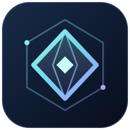

<p align="center"></p>
<h1 align="center">Âmago</h1>
<p align="center">Escrita em Markdown, arquivos locais e conhecimento conectado.<br>Aplicativo para Windows e navegador, com uma interface feita para explorar ideias.</p>
<p align="center"><a href="https://github.com/Nixye/amago/releases/latest">Baixar para Windows</a> · <a href="#primeiros-passos">Primeiros passos</a> · <a href="docs/extensions.md">Temas e plugins</a> · <a href="#desenvolvimento">Desenvolvimento</a></p>

## O que é o Âmago

O Âmago reúne um editor Markdown, uma biblioteca pessoal e projetos baseados em pastas reais. Você pode escrever, encontrar referências e explorar conexões sem depender de sincronização em nuvem. O aplicativo é independente e não possui vínculo com o Obsidian.

- **Navegação organizada:** abas Explorar e Coleções, busca em modal, rolagem preservada, menus de contexto e seletor de workspace.
- **Projetos locais:** subpastas, edição de Markdown, JSON, CSV, TXT e outros textos, criação de notas e visualização de imagens.
- **Busca híbrida:** combine nome, conteúdo, tags, menções e datas; remova filtros individualmente.
- **Mapa interativo:** busca híbrida, vínculos animados, pontos arrastáveis, zoom, cores, vizinhança e organizações orgânica, circular ou por pasta.
- **Escrita:** até quatro notas editáveis lado a lado, prévia Markdown, sugestões de páginas/tags/menções, wikilinks, tarefas, notas diárias, favoritos, modelos e modo foco.
- **Personalização:** seis temas nativos, tema inspirado em Cyberpunk, paletas da comunidade e plugins com permissões explícitas.
- **Windows:** instalador e versão portátil x64, ícone próprio e acrílico nativo com densidade ajustável.

## Instalação no Windows

Na [última release](https://github.com/Nixye/amago/releases/latest), escolha:

| Arquivo | Uso |
| --- | --- |
| `Amago-<versão>-Setup-x64.exe` | Instalação com escolha de diretório e atalhos. |
| `Amago-<versão>-Portable-x64.exe` | Execução sem instalação; os dados continuam no perfil do Windows. |
| `SHA256SUMS.txt` | Resumos SHA-256 dos executáveis publicados. |

Os executáveis são destinados ao Windows x64 e ainda não possuem assinatura digital comercial. O acrílico requer Windows 11 22H2 ou superior; em sistemas sem suporte, o aplicativo usa fundo sólido. O resultado também depende das configurações visuais do Windows. No navegador, a transparência é interna à página e não revela o papel de parede do sistema.

## Primeiros passos

### Atualizar o aplicativo

Abra **Configurações → Atualizações** e clique em **Verificar atualizações**. O Âmago compara a versão instalada com a última release estável de `Nixye/amago`, mostra as novidades e oferece os downloads disponíveis. A consulta é manual; falhas de conexão ou de acesso são informadas sem indicar falsamente que o aplicativo está atualizado.

Quando houver uma atualização, use **Baixar instalador (.exe)** ou **Baixar versão portátil**. O navegador realiza o download. Depois, feche o Âmago e execute o instalador, ou substitua o executável portátil pelo novo. A biblioteca permanece em `%APPDATA%/amago`; a instalação não ocorre automaticamente.

Se o repositório for privado, a consulta pela API exige um token pessoal com acesso a `Nixye/amago` e permissão **Contents: read**. O campo **Acesso a repositório privado** usa o token somente na consulta, sem gravá-lo nas configurações ou exportações. O download depende do login no GitHub pelo navegador. Como alternativa, **Abrir releases no GitHub** permite acessar as versões diretamente com a conta conectada. Consulte a [documentação de releases do GitHub](https://docs.github.com/en/rest/releases/releases#get-the-latest-release).

Na versão web, **Salvar e recarregar** salva os documentos abertos antes de carregar a publicação atual; um erro de salvamento impede a recarga.

### Escolher seu espaço

1. Após a abertura animada, escolha **Meu universo**, **Abrir pasta** ou um dos **Projetos recentes** no seletor inicial.
2. Para trabalhar com arquivos existentes, clique em **Abrir pasta** e selecione um diretório. A **Central do projeto** mostra um resumo das pastas, documentos, imagens e conexões; a árvore fica na barra lateral.
3. Expanda as subpastas e abra um Markdown, texto ou imagem. Use **Ctrl S** para gravar os textos no arquivo original.
4. Use **Buscar** para refinar resultados e **Mapa do projeto** para explorar os wikilinks.
5. Acesse **Configurações → Aparência** ou **Configurações → Plugins** para personalizar a experiência.

O seletor acima das abas reabre a janela de espaços. As últimas 12 pastas ficam em **Projetos recentes**, com busca e remoção da lista sem excluir os arquivos. No Windows, um clique reabre a pasta; se ela tiver sido movida, selecione o novo local com **Abrir pasta**. No navegador, os identificadores das pastas ficam no IndexedDB, e a reabertura pode solicitar permissão novamente. Se o armazenamento persistente estiver indisponível, a lista avisa que o projeto está disponível apenas na sessão.

Na web, a edição de pastas depende da File System Access API, disponível em navegadores compatíveis como Chrome e Edge, em HTTPS ou localhost. A permissão é concedida no seletor do navegador; sem essa API, o espaço pessoal e a importação/exportação continuam disponíveis.

Em **Configurações → Geral**, desative **Mostrar splash animada ao iniciar** para ir diretamente ao seletor de espaços nas próximas aberturas. A preferência é salva automaticamente.

### Espaço pessoal e projetos

| Comportamento | Meu universo | Pasta aberta como projeto |
| --- | --- | --- |
| Armazenamento | Biblioteca local do app/navegador | Arquivos originais da pasta selecionada |
| Salvamento | Automático | Ctrl S; também antes de trocar de arquivo/workspace e ao fechar o desktop |
| Organização | Pastas lógicas, tags e favoritos | Estrutura real de diretórios |
| Histórico e recuperação | Histórico de notas e lixeira recuperável | Cópias anteriores de renomeações e remoções em `.amago/operations` |
| Busca e mapa | Notas da biblioteca | Textos indexados; mapa das notas Markdown |
| Backup automático | Cópia diária anterior no desktop | Cópia antes de renomear/remover; mantenha também seu backup ou versionamento |

Se um arquivo mudar no disco desde a leitura, o Âmago bloqueia a gravação, mantém o rascunho e oferece **Exportar rascunho** e **Recarregar do disco**. O aplicativo não mescla alterações automaticamente. Use **Atualizar arquivos** para reler a árvore e reconstruir o índice após mudanças externas.

### Renomear, remover e criar em uma pasta

No explorador, clique com o **botão direito** em um arquivo ou pasta, use o botão **⋯** da linha ou pressione **Shift F10** com a linha focada. Pastas também oferecem **Nova nota nesta pasta**.

**Renomear** abre uma prévia dos documentos e da quantidade de vínculos que serão adaptados. A confirmação atualiza wikilinks, links Markdown locais e menções que resolvem para documentos; preserva os rótulos e fragmentos e recalcula caminhos relativos quando uma pasta muda. Aliases continuam funcionando. Código, comentários, links externos e referências sem destino conhecido não são alterados. No projeto, mantenha a extensão do arquivo.

**Remover** mostra os arquivos afetados e as notas que os referenciam. No espaço pessoal, as notas vão para a lixeira. Em projetos, o conteúdo anterior fica em `.amago/operations/<identificador>/original`, mantendo os caminhos relativos; `manifest.json` registra a operação. Para recuperar, feche os arquivos afetados no editor e copie o conteúdo de `original` de volta aos respectivos caminhos do projeto. Confira os arquivos atuais antes de substituí-los. Essas cópias não são removidas automaticamente.

O Âmago verifica novamente os arquivos após a prévia. Mudanças externas interrompem a operação e exigem nova revisão. Uma falha pode deixar a cópia no novo nome para conferência; a mensagem informa o local de recuperação. Não há uma transação atômica entre vários arquivos, especialmente no navegador. As operações verificadas aceitam até 3.000 itens, 12 níveis e 100 MB de conteúdo lido; arquivos Markdown devem ser UTF-8 e ter até 5 MB. Pastas com diretórios protegidos ou links simbólicos não são removidas ou renomeadas pelo app.

## Abrir pastas do Obsidian e arquivos de texto

Ao abrir uma pasta, o Âmago indexa automaticamente seus documentos e interpreta os metadados existentes. Não é necessário converter ou regravar a pasta inteira. O botão **Propriedades**, acima do editor Markdown, permite editar tags, aliases, data e cor do ponto; outras propriedades YAML e o corpo da nota são preservados nessa operação.

- Tags no corpo, como `#teste`, `**#ideia**` e `#estudo/livros`, entram nas coleções, na busca e nos filtros do mapa.
- Menções `@luna`, wikilinks e links relativos participam da busca. Destinos que correspondem a notas geram conexões.
- Propriedades `tags`, `aliases`, `date` e `color` são lidas do frontmatter. Listas em linha e listas com hífen são aceitas; código e comentários não geram tags.
- A pasta `.obsidian` é ignorada. Configurações, plugins, Canvas e funcionalidades exclusivas do Obsidian não são importados.

JSON, JSONC, CSV, TSV, TXT, LOG, YAML, TOML, XML, INI, arquivos de configuração e extensões comuns de código podem ser editados como texto. CSV não possui uma grade de planilha; HTML e scripts são exibidos como texto, sem execução. A lista completa está em [file-core.js](dist/file-core.js). Imagens abrem no visualizador interno.

Referências de formato: [propriedades](https://obsidian.md/help/properties), [links](https://obsidian.md/help/links) e [aliases do Obsidian](https://obsidian.md/help/aliases).

## Organização do editor

Em **Coleções**, clique em **Acesso rápido** ou **Tags** para recolher cada grupo. A busca da categoria filtra os nomes das tags; a lista mostra até 12 por página, com contagem de notas e navegação entre páginas. Selecionar uma tag abre a busca híbrida.

Use **Dividir** no topo do editor para escolher outra nota. É possível abrir até quatro colunas do mesmo workspace, trocar a nota pelo título de cada coluna e alternar individualmente entre edição e prévia. **Uma coluna** retorna ao editor normal. No projeto, **Ctrl S** salva todos os rascunhos abertos; conflitos preservam o conteúdo da coluna afetada. Em janelas pequenas, as colunas têm rolagem horizontal.

Cada aba possui um botão de fechar; **Ctrl W** fecha a aba ativa. Os arquivos do projeto são salvos antes do fechamento e um conflito mantém o rascunho aberto. Ao fechar a última aba, a Central volta a aparecer.

Arraste os divisores entre edição e prévia, entre colunas ou na borda do painel de conexões para ajustar as larguras. As proporções ficam salvas; um duplo clique no divisor restaura o padrão. Com o divisor focado, use as setas, Home ou End.

O botão **Conexões** oculta ou reexibe as referências da nota ativa. Ele separa links de saída, links de retorno e destinos não encontrados, incluindo imagens e outros arquivos do projeto. O botão de painel na barra superior ou o botão na própria barra lateral alterna entre fixada e recolhida. Quando recolhida, aproxime o mouse da borda esquerda para revelá-la temporariamente; afastar o ponteiro a recolhe. O estado fixado/recolhido, a visibilidade das conexões e os grupos recolhidos são preservados ao reiniciar. A divisão em colunas dura a sessão atual.

**Configurações** reúne as abas **Geral**, **Aparência**, **Dados**, **Plugins** e **Atualizações** em uma janela adaptada à altura da tela, com conteúdo rolável. As preferências são salvas ao alterar os controles; formulários com botão de salvar mantêm a ação no rodapé do diálogo. **Buscar**, ou **Ctrl K**, abre um diálogo com resultados navegáveis pelas setas e Enter.

### Sugestões ao escrever

Digite `[[` para sugerir páginas, `#` para tags ou `@` para menções e páginas do workspace atual. **Ctrl Espaço** abre as sugestões manualmente; continue digitando para filtrar. Use **↑/↓** para navegar, **Enter/Tab** para inserir e **Esc** para fechar. As páginas incluem o caminho para distinguir nomes iguais. Uma menção a uma página é inserida como `@[[caminho|nome]]`; menções simples usam `@nome`.

As sugestões funcionam em Markdown, inclusive nas colunas de edição, e não aparecem dentro de código ou comentários. A lista mostra até 20 correspondências por vez.

No Windows, dê duplo clique na barra superior para maximizar ou restaurar a janela.

## Busca híbrida

Todos os critérios são combinados com **E**: um resultado precisa satisfazer cada filtro. A busca ignora diferenças de maiúsculas e acentos. Use aspas para valores com espaços e `-` para excluir um critério.

| Consulta | Encontra |
| --- | --- |
| `pesquisa visual` | Ambos os termos no nome, caminho ou conteúdo |
| `name:Atlas content:"pesquisa visual"` | Nome/caminho contendo Atlas e a frase no conteúdo |
| `#design` ou `tag:design` | Tag nas propriedades ou no corpo, incluindo subtags como `design/web` |
| `@luna` ou `mention:"Outra nota"` | Menções `@pessoa` ou destinos de `[[wikilinks]]` |
| `date:2026-11` | Notas datadas em novembro de 2026 |
| `after:2026-11-01 before:2026-11-30` | Intervalo de datas inclusivo |
| `projeto #design @luna -tag:arquivado` | Combinação dos quatro critérios |

A data usa a propriedade `date` quando presente; caso contrário, a data de modificação. Tags e menções dentro de blocos de código não entram nesses filtros. O formulário **Refinar por tags, menções e datas** ajuda a adicionar tags, menções e intervalos; os filtros aparecem como botões removíveis. No mapa, **Usar busca atual** copia a consulta atual.

## Mapa e propriedades Markdown

O mapa conecta notas por wikilinks, aliases, links Markdown locais e menções que correspondem a outras notas. Aceita `[[Nome da nota]]`, `[[pasta/arquivo#Seção|Rótulo]]` e `[Rótulo](../arquivo.md)`. No projeto, destinos da mesma pasta têm prioridade; nomes repetidos devem usar o caminho completo para evitar ambiguidade.

Também reconhece links com espaços (`[Nota](<pasta/Minha nota.md>)`), caminhos codificados (`Minha%20nota.md`), parênteses e referências Markdown `[Nome][id]` com sua definição. Links `file://` só são resolvidos quando apontam para dentro da pasta aberta. Um fragmento `#Título` abre a nota e procura o título na prévia; referências a blocos não possuem navegação específica. Imagens incorporadas com `![[imagem.png]]` e `` aparecem na prévia do projeto.

O mapa reúne notas Markdown; o painel **Conexões** também mostra outros arquivos. Os filtros mostram apenas pontos correspondentes e os vínculos entre eles. A lateral contém uma prévia de até oito vizinhos clicáveis; **Mapa desta nota** abre a vizinhança no mapa completo.

Arraste um ponto para reposicioná-lo; arraste o fundo para navegar; use a roda do mouse ou os controles para ampliar. Os ajustes de posição, tamanho dos pontos e espessura das linhas ficam salvos localmente por workspace. Escolha **Organização → Orgânica, Circular ou Por pasta** para mudar a distribuição. **Nomes** alterna os rótulos. Selecione um ponto e use **Focar nota selecionada**, com uma vizinhança de um, dois ou três níveis; **Mostrar todo o mapa** remove esse foco. A busca e o filtro de vínculos continuam combinados com essa seleção. **Reorganizar pontos** restaura a distribuição escolhida. A animação respeita a preferência de movimento reduzido do sistema.

A cor pode ser escolhida nas **Propriedades da nota/Markdown**, no seletor de um ponto do mapa ou declarada no começo do arquivo:

```markdown
---
tags: [design, projeto]
color: "#78e2df"
date: 2026-11-12
---

# Atlas de ideias

Pesquisa com @luna, conectada a [[Próximos passos]].
```

O seletor de cor grava a propriedade `color` no Markdown, preservando as demais propriedades. São aceitas cores hexadecimais de seis dígitos. O parser reconhece propriedades simples e listas de tags; não é uma implementação completa de YAML.

## Temas e plugins

Os temas nativos são **Orbital, Cyberpunk, Meia-noite, Floresta, Quartzo e Alvorada**. O tema Cyberpunk é uma interpretação visual com amarelo, magenta e superfícies escuras; não inclui recursos oficiais do jogo.

Temas da comunidade são importados e exportados em JSON. Plugins são instalados por pacote JSON e têm ativação individual. A API v2 oferece painéis com HTML/CSS, comandos na paleta e na barra superior, configurações, eventos, armazenamento próprio e acesso autorizado aos documentos do workspace. O gerenciador mostra as permissões antes de ativá-los; alterações propostas por um plugin exigem revisão. Não há catálogo online ou atualização automática de extensões nesta versão.

Veja [como criar temas e plugins](docs/extensions.md) e os [pacotes de exemplo](examples/). A API é própria do Âmago; plugins do Obsidian não são compatíveis diretamente.

## Atalhos

| Atalho | Ação |
| --- | --- |
| Ctrl K | Abrir busca híbrida |
| Ctrl N | Nova nota ou novo arquivo Markdown |
| Ctrl S | Salvar os arquivos abertos, incluindo as outras colunas |
| Ctrl W | Fechar a aba ativa |
| Ctrl Shift D | Adicionar uma nota lado a lado |
| Ctrl E | Alternar edição/leitura |
| Ctrl Shift P | Abrir paleta de comandos |
| Esc | Fechar diálogo ou sair do modo foco |
| Setas, Home e End nas abas laterais | Trocar painel da barra lateral |

## Dados e privacidade

No Windows, a biblioteca fica em `%APPDATA%/amago/vault.json`. **Configurações → Dados → Abrir pasta de dados** mostra o diretório exato. As gravações são serializadas e usam arquivo temporário seguido de renomeação. A lista de projetos recentes fica em `projects.json` nesse mesmo diretório, contendo nomes, caminhos e datas de abertura, sem copiar os documentos. A primeira gravação de cada dia preserva a cópia anterior em `backups/`. O fechamento da janela aguarda o salvamento e permanece aberto se houver erro.

Na web, a biblioteca usa o armazenamento local do navegador. Limpar os dados do site remove essa biblioteca e os identificadores de projetos recentes. Os projetos usam apenas a pasta explicitamente selecionada; seu conteúdo não é importado para o espaço pessoal.

O app não envia o conteúdo das notas para um servidor nem oferece sincronização automática. Fontes externas opcionais podem ser solicitadas pelo navegador; há fontes locais de fallback. Plugins são executados em um iframe isolado, com API restrita e sem conexões de rede permitidas pelo aplicativo.

Para transferir notas, exporte o espaço em JSON e importe no outro dispositivo. A importação adiciona notas ativas; não restaura histórico, lixeira, temas ou plugins. Para recuperação integral no Windows, feche o app, preserve o `vault.json` atual e substitua-o por uma cópia válida do backup.

## Compatibilidade e limites

- Markdown: títulos, parágrafos, listas, tarefas, citações, código, negrito, itálico, links HTTP(S) e wikilinks. HTML é escapado. Tabelas, LaTeX e Canvas não estão implementados.
- Edição de arquivos: UTF-8, até 5 MiB por arquivo editável. UTF-16, conteúdo binário e UTF-8 inválido são rejeitados. O editor pode normalizar quebras de linha ao editar.
- Imagens: PNG, JPEG, GIF, WebP, BMP, SVG, AVIF e ICO, até 25 MiB. Word, Excel, PDF e outros formatos não editáveis exibem um aviso de formato ainda não suportado.
- Árvore: até 3.000 itens e 12 níveis. `.git`, `.obsidian`, `.amago`, `node_modules`, `.svn`, `.hg` e links simbólicos/junções não são percorridos pelo desktop.
- Índice de conteúdo: orçamento aproximado de 40 MiB por projeto; arquivos fora do índice continuam localizáveis pelo nome. A interface informa leituras ignoradas.
- Mapa: até 500 notas por consulta. Refine os filtros para visualizar partes de acervos maiores.
- O app abre um projeto de pasta por vez e não monitora mudanças externas em tempo real.

## Desenvolvimento

Requer Node.js 24 e npm. Para gerar os executáveis, use Windows x64.

```sh
npm ci
npm test
npm run web
```

A web fica disponível em `http://localhost:4173`.

```sh
npm start          # aplicativo Electron
npm run dist:win   # instalador e portátil em release/
```

Caso o ambiente bloqueie scripts de instalação do npm, execute `node node_modules/electron/install.js` para instalar o runtime antes de iniciar o desktop.

| Diretório | Responsabilidade |
| --- | --- |
| `dist/` | Interface estática, busca, mapa, temas e runtime de plugins |
| `desktop/` | Electron, janela nativa, persistência e acesso às pastas |
| `tests/` e `verify.mjs` | Verificação de Markdown, histórico, arquivos, busca e extensões |
| `examples/` | Pacotes de extensões para desenvolvimento |
| `.github/workflows/windows.yml` | Compilação e publicação dos executáveis |

A interface usa JavaScript, HTML, CSS e SVG, sem framework de frontend. O Electron executa com sandbox, isolamento de contexto e Node desativado no renderer. A ponte IPC valida a origem e expõe operações específicas. Referências: [segurança no Electron](https://www.electronjs.org/docs/latest/tutorial/security/) e [isolamento de iframes](https://developer.mozilla.org/en-US/docs/Web/HTML/Reference/Elements/iframe#sandbox).

### Publicar uma release

1. Atualize `package.json` e `package-lock.json` com `npm version <versão> --no-git-tag-version`.
2. Execute `npm test` e faça commit das alterações.
3. Crie a tag `v<versão>` e envie a branch e a tag ao GitHub.

O GitHub Actions valida a versão, testa, compila os dois executáveis e publica uma release com SHA-256. A execução manual do workflow gera artefatos sem criar release. Apenas o job de publicação recebe `contents: write`; não é necessário um token pessoal no workflow.

O modo `npm run dist:win:signed` prepara executáveis com assinatura Authenticode obrigatória e verificação do editor, certificado e carimbo de tempo. Ele requer um certificado de Code Signing emitido e configurado no Windows. A contratação e a integração da assinatura no CI ainda estão pendentes; veja [assinatura de executáveis Windows](docs/windows-signing.md).

## Relatar problemas

Ao abrir uma issue, inclua a versão do Âmago, a versão do Windows ou navegador, os passos para reproduzir e se o problema ocorre no espaço pessoal ou em um projeto. Use um arquivo de exemplo sem conteúdo privado quando necessário. Problemas em extensões devem incluir o nome e a versão do pacote.
